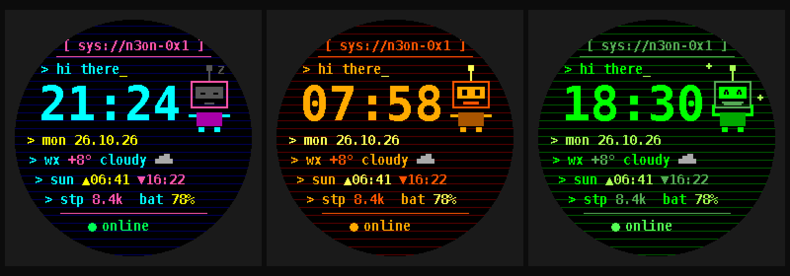

# connectiq-watchface-kit

🇬🇧 English · 🇷🇺 [Русский](README.ru.md)

Build Garmin Connect IQ watch faces with [Claude Code](https://claude.com/claude-code). It comes with a ready skill, slash commands, pixel-font tooling and a complete reference face that has been verified on a real Forerunner 945.



## Quick start (5 minutes)
```bash
git clone https://github.com/vitalikryzhenkous/connectiq-watchface-kit.git
cd connectiq-watchface-kit
pip install pillow
claude
```
Then type in Claude Code:
```
/wf-new minimal amber digital face for fenix7 with steps and weather
```
Claude asks a few questions, shows a mockup, generates the project in `faces/<name>/` and tells you how to build it.

To build and run on your watch you need the free Garmin SDK. Follow **[docs/build-and-run-mac.md](docs/build-and-run-mac.md)**: VS Code + Monkey C extension + SDK Manager, then simulator, then sideload over USB.

## Commands
| Command | What it does |
|---|---|
| `/wf-new <idea>` | Designs a face: questions, SVG mockup, full project, PNG preview |
| `/wf-preview <dir>` | Renders a pixel-accurate PNG preview without the simulator |
| `/wf-add-device <dir> <ids>` | Adds devices (MIP/AMOLED, 240–454 px) |
| `/wf-debug <log>` | Fixes compiler errors or an `IQ!` crash from `CIQ_LOG.YML` |
| `/wf-store <dir>` | Prepares a Connect IQ Store release: screenshots and a listing in 4 languages |

The `connectiq-watchface` skill loads automatically for any Garmin/Connect IQ task inside this repo.

### Use it in all your projects
```bash
mkdir -p ~/.claude/skills ~/.claude/commands
ln -s "$PWD/.claude/skills/connectiq-watchface" ~/.claude/skills/connectiq-watchface
ln -s "$PWD"/.claude/commands/wf-*.md ~/.claude/commands/
```

## No Claude Code? Use the parts
| Path | Use |
|---|---|
| `templates/n3on-terminal/` | Copy, change the UUID, build. Pure Monkey C. |
| `scripts/gen_font.py` | Any TTF → crisp Connect IQ bitmap font (`.fnt` + `.png`) |
| `scripts/gen_icon.py` | Pixel launcher icon |
| `scripts/preview_n3on.py` | Layout preview and store screenshots |
| `.claude/skills/connectiq-watchface/references/pitfalls.md` | Compiler, runtime and tooling gotchas |

## N3on Terminal (reference face)
A cyberpunk terminal face with glitched time, weather, sunrise and sunset (computed on the watch), steps, battery, phone status, and an original pixel bot that sleeps at night, cheers at your step goal and looks tired at low battery. It has 3 themes and phone settings, needs no permissions and collects no data.

## Security
- Never commit your developer key (`developer_key`, `*.der`, `*.pem`). These are already in `.gitignore`. If you lose it, you can't update your store app.
- Publishing a fork? Generate a new app UUID: `python3 -c "import uuid;print(uuid.uuid4().hex)"`.
- Use original art only. No third-party logos or characters, and no "Garmin" in the app name.
- Report issues privately, as described in [SECURITY.md](SECURITY.md).

## License
MIT. The bitmap fonts are derived from DejaVu Sans Mono and use the [Bitstream Vera license](templates/n3on-terminal/resources/fonts/LICENSE-DejaVu.txt).
Not affiliated with or endorsed by Garmin.
