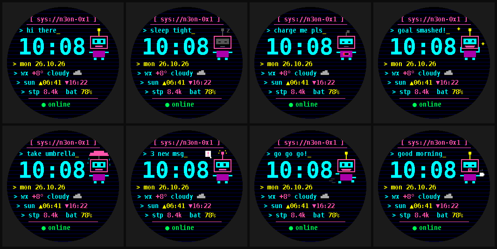
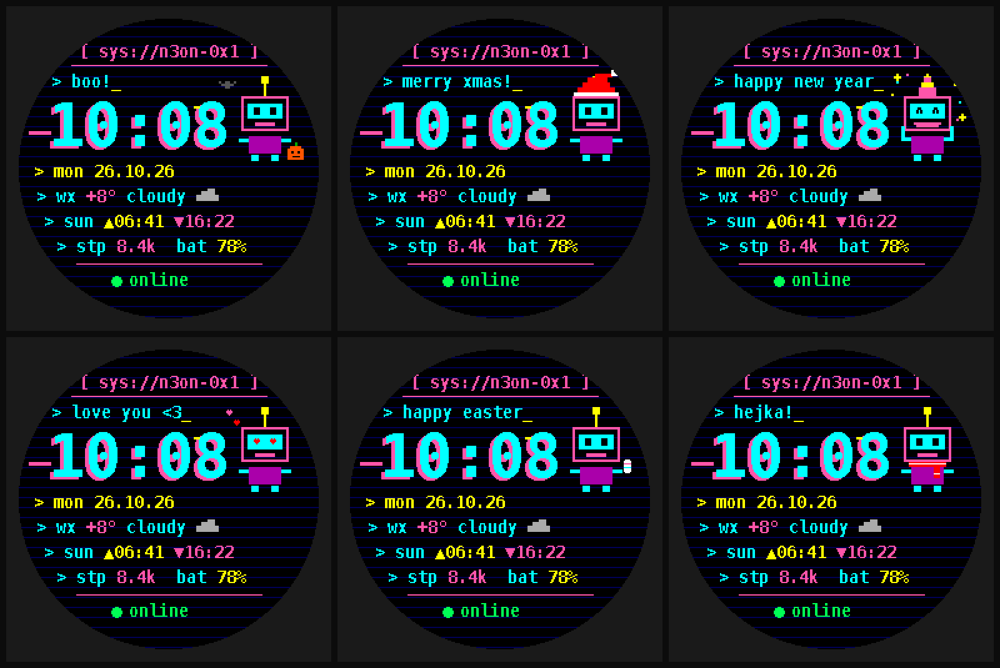
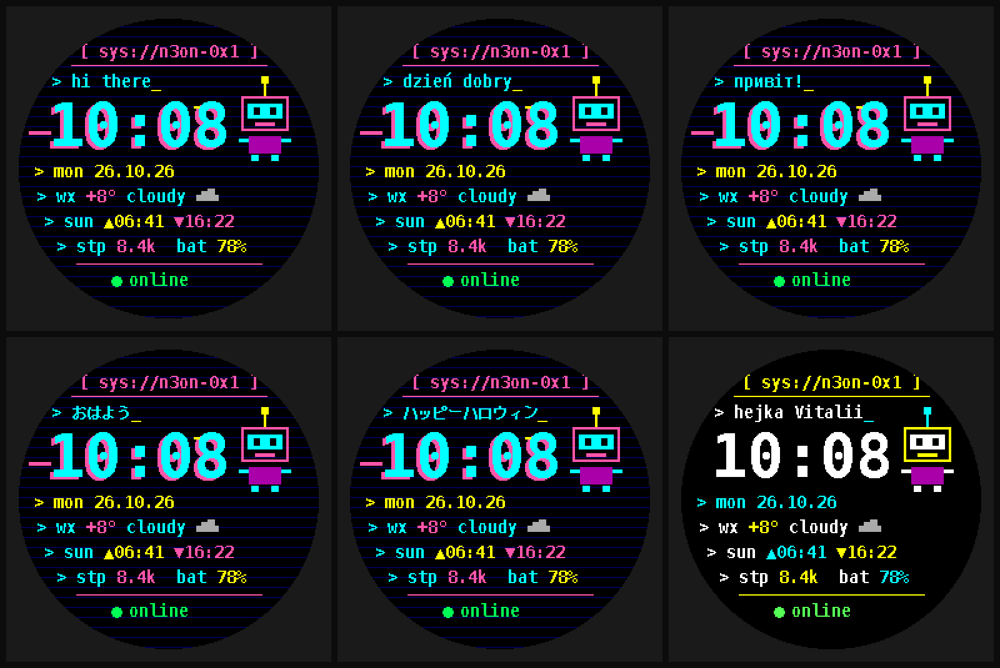

# connectiq-watchface-kit

🇬🇧 English · 🇷🇺 [Русский](README.ru.md)

[](https://apps.garmin.com/en-US/apps/bf1ea0aa-ea66-4dc3-b44e-e311fd759965) [](https://github.com/vitalikryzhenkous/connectiq-watchface-kit/actions/workflows/ci.yml) [](https://buymeacoffee.com/vitaliiryzhenko)

Build Garmin Connect IQ watch faces with [Claude Code](https://claude.com/claude-code). It comes with a ready skill, slash commands, pixel-font tooling and a complete reference face that has been verified on a real Forerunner 945.


## What you need
- [Claude Code](https://claude.com/claude-code) for the skill and commands. It's optional: the parts also work on their own, see below.
- Python 3.9+ with `pip install pillow`
- To build for a real watch: VS Code, the Monkey C extension, and Garmin's Connect IQ SDK Manager (free account). Setup guide: [docs/build-and-run-mac.md](docs/build-and-run-mac.md).
- A Garmin watch is optional. The SDK simulator is enough to start.

## Quick start (5 minutes)
```bash
git clone https://github.com/vitalikryzhenkous/connectiq-watchface-kit.git
cd connectiq-watchface-kit
pip install pillow
claude
```
Then type in Claude Code:
```
/wf-new minimal amber digital face for fenix7 with steps and weather
```
Claude asks a few questions, shows a mockup, generates the project in `faces/<name>/` and tells you how to build it.

To build and run on your watch you need the free Garmin SDK. Follow **[docs/build-and-run-mac.md](docs/build-and-run-mac.md)**: VS Code + Monkey C extension + SDK Manager, then simulator, then sideload over USB.

## Commands
| Command | What it does |
|---|---|
| `/wf-new <idea>` | Designs a face: questions, SVG mockup, full project, PNG preview |
| `/wf-preview <dir>` | Renders a pixel-accurate PNG preview without the simulator |
| `/wf-add-device <dir> <ids>` | Adds devices (MIP/AMOLED, 240–454 px) |
| `/wf-debug <log>` | Fixes compiler errors or an `IQ!` crash from `CIQ_LOG.YML` |
| `/wf-location <city\|reset>` | Sets the sunrise/sunset location for sideload testing (offline lookup, city level) |
| `/wf-release-check <dir>` | Pre-release gate: automated checks plus a manual checklist before the store export |
| `/wf-store <dir>` | Prepares a Connect IQ Store release: screenshots and a listing in 4 languages |

The `connectiq-watchface` skill loads automatically for any Garmin/Connect IQ task inside this repo.

### Use it in all your projects
```bash
mkdir -p ~/.claude/skills ~/.claude/commands
ln -s "$PWD/.claude/skills/connectiq-watchface" ~/.claude/skills/connectiq-watchface
ln -s "$PWD"/.claude/commands/wf-*.md ~/.claude/commands/
```

## MCP server (Claude Desktop, Cursor, any MCP client)
```bash
pip install -r mcp/requirements.txt
claude mcp add connectiq -- python3 "$PWD/mcp/server.py"
```
Tools: `scaffold_face`, `gen_font`, `render_preview`, `lint`, `device_info`. It runs locally with no network access. Details are in [mcp/README.md](mcp/README.md).

## ConnectIQ-Bench
A small eval that tests whether an LLM can write a working Monkey C watch face. It has 10 tasks from easy to hard, static checks, and an optional compile step with your local SDK.
```bash
python3 bench/run.py --all --project templates/n3on-terminal
```
See [bench/README.md](bench/README.md).

## No Claude Code? Use the parts
| Path | Use |
|---|---|
| `templates/n3on-terminal/` | Copy, change the UUID, build. Pure Monkey C. |
| `scripts/gen_font.py` | Any TTF → crisp Connect IQ bitmap font (`.fnt` + `.png`) |
| `scripts/gen_icon.py` | Pixel launcher icon |
| `scripts/preview_n3on.py` | Layout preview and store screenshots |
| `scripts/set_location.py` | `--city "Poznań"`, `--lat/--lon` or `--reset` for the Lat/Lon defaults (offline, optional `pip install geonamescache`) |
| `scripts/release_check.py` | Release gate: lint, location reset, settings/strings, naming, store assets, secrets, git |
| `scripts/ciq_lint.py` | Manifest, resources and MIP 64-color palette checks (no SDK needed) |
| `datasets/` | Opt-in, local-only log of your own compiler-error → fix pairs ([details](datasets/README.md)) |
| `.claude/skills/connectiq-watchface/references/pitfalls.md` | Compiler, runtime and tooling gotchas |

## N3on Terminal (reference face)
**Install it from the Connect IQ Store: [N3on Terminal](https://apps.garmin.com/en-US/apps/bf1ea0aa-ea66-4dc3-b44e-e311fd759965)** (Forerunner 945, 945 LTE, 745).

A cyberpunk terminal face with glitched neon time (always, on wrist raise or off), weather, sunrise and sunset (computed on the watch), steps, battery, phone status, and an original pixel bot that sleeps at night, cheers at your step goal and looks tired at low battery. It has 4 themes (including High contrast) and 12 phone settings, needs no permissions and collects no data.

N3o has 8 emotions, picked automatically from data the face already reads: normal, night, low battery, step goal, rain, notification, running and morning.



Holiday looks switch on automatically by date: Halloween, Christmas, New Year, Valentine's Day, Easter and a winter scarf. You can turn them off in the settings.



N3o talks on the first line. Phrases react to the day (morning, rain, goal, notifications, holidays) in English, Polish, Ukrainian or Japanese, or show your own phrase. They're typed in after a wrist raise. A High contrast theme is there for bright sun and low vision.



## Security
- Never commit your developer key (`developer_key`, `*.der`, `*.pem`). These are already in `.gitignore`. If you lose it, you can't update your store app.
- Publishing a fork? Generate a new app UUID: `python3 -c "import uuid;print(uuid.uuid4().hex)"`.
- Use original art only. No third-party logos or characters, and no "Garmin" in the app name.
- Report issues privately, as described in [SECURITY.md](SECURITY.md).

## Support
The kit is free and MIT-licensed. If it saved you time, you can [buy me a coffee](https://buymeacoffee.com/vitaliiryzhenko) ☕. Need a custom watch face for your club, brand or event? Open an issue.

## License
MIT. The bitmap fonts are derived from DejaVu Sans Mono and use the [Bitstream Vera license](templates/n3on-terminal/resources/fonts/LICENSE-DejaVu.txt).
Not affiliated with or endorsed by Garmin.
